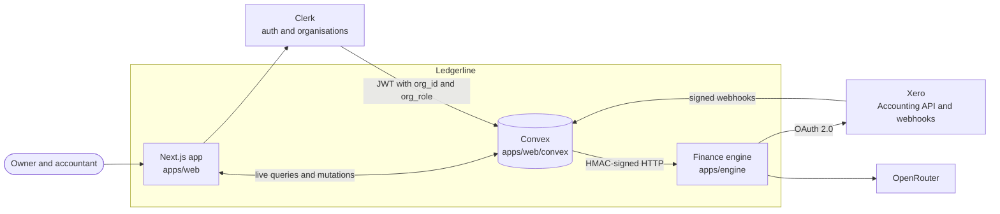
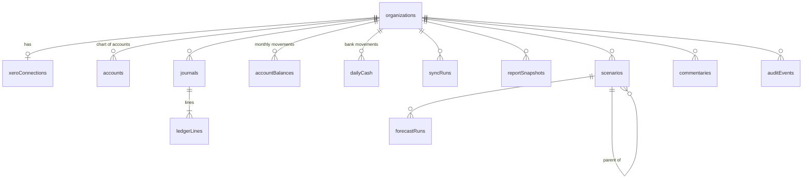
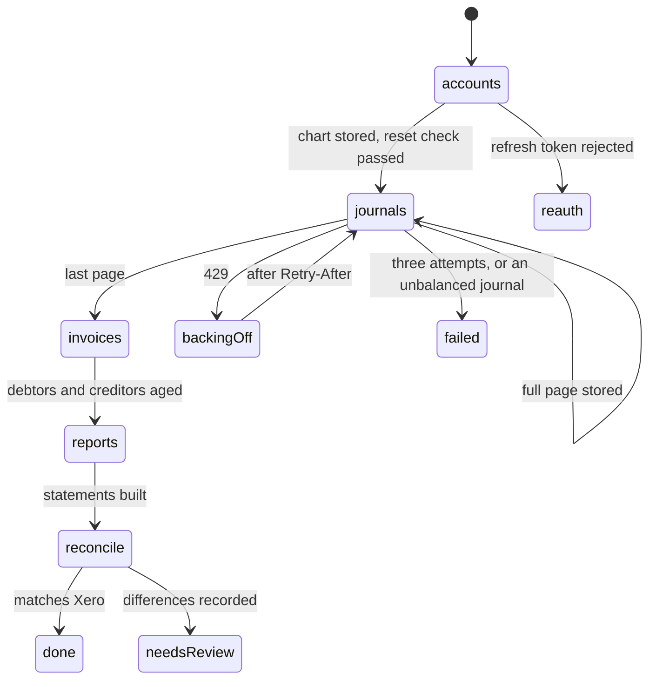

# Ledgerline architecture

Ledgerline connects a small company's Xero organisation, keeps its journals in sync, produces management
accounts that match Xero to the cent, and runs a linked three-statement forecast with branchable scenarios.

**The rule that shapes everything:** Convex owns state and orchestration, the Python engine owns computation
and Xero I/O, and the browser owns presentation. Nothing crosses that line.

## System context

The browser never holds a Xero token. Xero only ever sees requests from the engine; its webhooks land on a
Convex HTTP action that verifies the signature before doing anything.

## Containers

| Container | Responsibilities | Key files |
| --- | --- | --- |
| Web | Landing page, auth frame, every app screen, built from `@ledgerline/ui` | `app/`, `components/app/`, `lib/views.ts` |
| Convex | Tables, organisation scoping, roles, the sync state machine, OAuth state, encrypted tokens, snapshots, scenarios, forecast cache, audit log, crons | `convex/*.ts` |
| Engine | Xero client, journal normalisation, statements, forecast, reconciliation, commentary | `apps/engine/ledgerline_engine/` |
| Design system | Tokens, components, charts, icons | `packages/ui/` |

## Data model

Money is `v.int64()` cents in every Convex table that stores amounts.

- **Every read is scoped.** `lib/auth.ts` resolves the caller's Clerk organisation (from the `convex` JWT
  template) to an organisation document; every query filters through an index that starts with `orgId`.
- **Journals are append-only.** The unique key `(orgId, xeroJournalId)` makes every page safe to store twice.
- **Balances are maintained on write.** `storePage` updates `accountBalances` (account × month) and
  `dailyCash` in the same transaction as the lines, so statements never rescan the ledger.
- **`actualsVersion`** on the organisation increments after each successful rebuild; forecast runs and
  snapshots record the version they were built from.
- **Audit events are insert-only.**

## The Xero sync

Every Xero organisation connects through one Ledgerline app, so what can be read depends on the scopes
Xero has granted **the app**, not on the customer's Xero plan. Xero gives journal access only to apps it has
approved for it; every other app gets reports and documents. Each connection stores the scopes Xero granted
and syncs in one of two modes, chosen per connection:

| Mode | When | Monthly movements from | Drill-down | Daily cash |
| --- | --- | --- | --- | --- |
| `journals` | The app holds `accounting.journals.read` (`LL_XERO_JOURNALS=true` on the engine) | Every posted journal | Journal lines | Bank lines in journals |
| `reports` | Every other app (the default) | One Trial Balance per month end: month columns for movements, year-to-date columns for the opening position | Invoices, bills, credit notes, payments, bank transactions and manual journals, read on demand and cached; the remainder shown as other postings | Payments and bank transactions |

Both modes fill the same `accountBalances` table, so statements, forecasts, scenarios, the board pack and
the check against Xero don't know which one ran. In reports mode, Xero's year-end roll-over of profit into
retained earnings (which journals never contain) is removed by requiring every month to sum to zero and
moving any residual to retained earnings; an engine test rebuilds two years of the sample company from
Xero-shaped trial balances and gets identical statements to the cent. If a connection gains or loses
journal access, the next sync clears the figures and rebuilds them in the new mode.

### Journals mode

Xero's Journals endpoint returns every posted journal in journal-number order, 100 per page. Journals are
never edited, so the whole sync needs one cursor: the last journal number stored.

### Reports mode

`accounts → balances → cash → invoices → reports → reconcile`. The first sync reads 26 month ends (the
opening position, 24 months and the current month to date), six per step; each night rereads the last three
months, replacing them whole so late postings land once. If the check against Xero then finds a difference
(an older month changed), one full refresh runs automatically.

| Case | Behaviour |
| --- | --- |
| Rate limit | The engine returns 429 with `retryAfter`; the step is rescheduled for then |
| Expired access token | The engine refreshes it and returns the rotated pair; Convex stores it before anything else |
| Rejected refresh token | Connection marked expired; the app shows "Reconnect"; figures are kept |
| Demo Company reset | `journal-check` finds the stored journal gone; the organisation's synced data is deleted in batches and the sync restarts |
| Webhook bursts | Each webhook schedules a sync 30 seconds later; a run already in progress sets `rerunRequested` instead |
| Crash mid-page | The cursor moves in the same mutation as the page, so a retry refetches at most one page |

## CSV import

The browser parses both files (`lib/importCsv.ts`) and explains every problem by row before anything is sent.
`imports.start` clears the organisation's figures and chart and stores the new chart; `imports.page` stores
journals in batches of about 800 lines through `storeJournals`, the same function a Xero sync uses, so balances
and daily cash are maintained identically; `imports.complete` builds the statements. An import is recorded as a
sync run with `source: "csv" | "sample"`, so progress, history and the audit log are shared.

- Imported IDs are prefixed `csv:` and an import refuses lines on accounts outside its own chart.
- Importing is refused while Xero is connected, so the nightly sync can't overwrite a file.
- Connecting Xero later replaces imported figures (`sync.claimForXero`) rather than mixing them.
- If the engine can't be reached, the journals are kept and the report step can be retried.

## Exports

Every report has an Export menu. **CSV** comes from the snapshot data (amounts in euro, two decimals; text that a
spreadsheet would treat as a formula is escaped). **HTML** clones the page on screen, drops controls, inlines the
stylesheets and the Latin font files as data URLs, and saves one file with no scripts, so charts stay sharp SVG
and the page looks the same offline. The ledger and chart of accounts export in the import format.

## Statements

Built in `statements/build.py` from monthly movements and the Xero account class and type
(`statements/classify.py`). Presentation follows paper conventions: income positive and costs negative in the
P&L; assets positive and liabilities negative in the balance sheet; equity positive.

- **Balance sheet:** equity accounts plus retained earnings from prior years plus current-year earnings. The
  builder raises if net assets ≠ total equity.
- **Cash flow (indirect):** net profit, add back depreciation, the change in each working-capital line,
  fixed assets net of depreciation, loans and equity. The builder raises if opening cash plus the net change
  ≠ closing cash.

## Forecast

`forecast/model.py` runs one month at a time:

- Revenue_t = Revenue_t−1 × (1 + g); cost of sales = revenue × (1 − margin)
- Overheads grow annually; each hire costs salary ÷ 12 × (1 + employer PRSI) × count from its start month
- Depreciation = base + capex to date ÷ useful life; interest = loan_t−1 × rate ÷ 12; tax = 12.5% × max(0, profit)
- Debtors = revenue × debtor days ÷ 30; stock = cost of sales × stock days ÷ 30; creditors = purchases × creditor days ÷ 30
- Cash_t = Cash_t−1 + net profit + depreciation − Δdebtors − Δstock + Δcreditors + Δtax payable − capex + Δloan + equity − dividends

Every month asserts assets − liabilities = equity. Runway is interpolated to the month cash first goes
negative. Bands come from 200 seeded runs perturbing growth, margin and debtor days. Sensitivity reruns the
base case at each driver's downside and upside.

**Scenarios** store overrides and plan items on a parent chain; `scenarios.resolve` walks base → branch.
Forecast runs are cached by a SHA-256 of the actuals version and every resolved input.

## Commentary

The engine builds facts (id, formatted value, source) from computed figures, asks OpenRouter for structured
output made of text segments and fact citations, and rejects any text segment containing a digit, a currency
sign or a percentage, retrying once. A person accepts the draft before the board pack can be exported.

## Security

| Concern | Control |
| --- | --- |
| Tenant isolation | Organisation resolved from the JWT in every function; indexes start with `orgId`; tested |
| Roles | Owner, editor, accountant; accountants can't change figures or scenarios |
| Xero tokens | AES-GCM encrypted with `LL_TOKEN_KEY`; decrypted only inside actions; never sent to the browser |
| OAuth | Authorisation code with PKCE and a single-use, 15-minute `state` |
| Webhooks | HMAC-SHA256 over the raw body, constant-time compare; 401 otherwise |
| Convex → engine | HMAC-SHA256 over timestamp, method, path and body; five-minute replay window |
| LLM | Only computed facts are sent, never ledger lines or contact details |

## Testing

| Layer | Tool | Proves |
| --- | --- | --- |
| Engine | pytest, Hypothesis, respx | Statements, forecast and Xero client; random ledgers and drivers always tie out |
| Convex | convex-test, Vitest | Scoping, roles, idempotent storage, scenario inheritance, forecast caching, webhook signatures |
| Web | TypeScript, Next build | Every screen type-checks and builds |

CI runs all of it on every push (`.github/workflows/ci.yml`).
